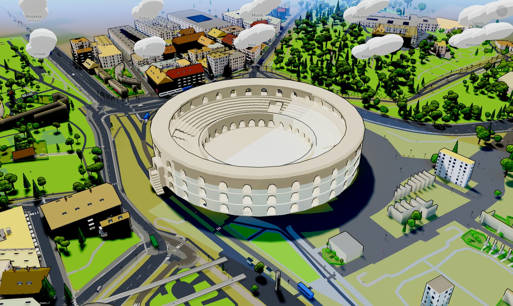
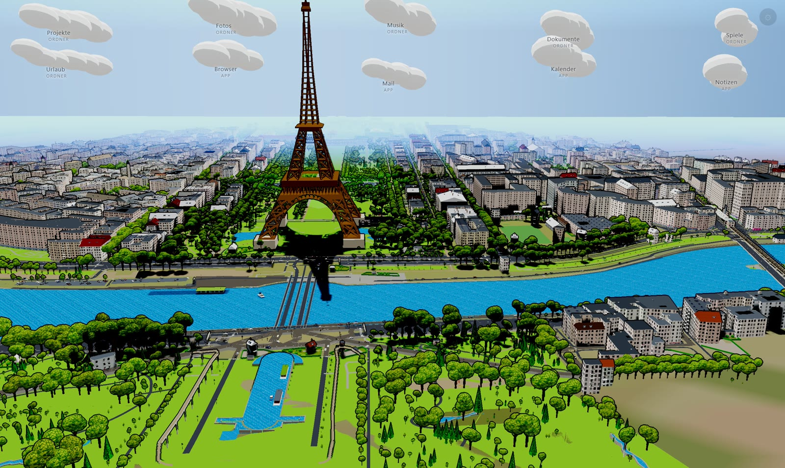

🇩🇪 Deutsch | [🇬🇧 English](README_EN)
# Hi, ich bin Xaver 👋

in meiner Freizeit baue ich gerne unterschiedliche Anwendungen. Von der ersten Idee über Konzept und Umsetzung bis zur
Veröffentlichung im Store, inklusive allem Unspektakulären dazwischen: Datenschutzerklärung,
Store-Assets, Beschreibungstexte.

Inhaltsverzeichnis:
- [Sofari](#sofari)
- [WaitDojo](#waitdojo)
- [Jobcrawler](#jobcrawler)
- [DesktopWorlds](#desktopworlds)
- [Kontakt](#kontakt)

-----------------------------------------------------------------------------------------------------------------------------------------------------------
## Projekt

## [Sofari](https://xaver-dev.github.io/sofari-landing/)
Möbel per Foto oder AR maßstabsgetreu im eigenen Raum platzieren, bevor man sie kauft. Automatisches Freistellen, Shop-Suche über viele
Anbieter, Farbabgleich für den Raum. Ohne Konto, ohne Werbung, ohne Kosten.
→ [Google Play](https://play.google.com/store/apps/details?id=app.sofari) · [im Browser testen](https://sofari.expo.app/) · [Landingpage](https://xaver-dev.github.io/sofari-landing/)

## Womit

React Native · Expo · Node.js · Bildverarbeitung · AR · Cloud-Infrastruktur ·
automatisierte Workflows · KI-gestützte Entwicklung

## Kontakt

kontakt@sofari.app

-----------------------------------------------------------------------------------------------------------------------------------------------------------
## Projekt

**[WaitDojo](https://github.com/xaver-dev/WaitDojo)** — Verwandelt die Wartezeit auf KI-Tools in
Lernzeit: läuft ein langer Vorgang in Claude Code oder ChatGPT, erscheint in der Bildschirmecke ein
kleines Quiz-Popup mit Karteikarten. Zu jedem Thema — du beschreibst es, ein Chatbot baut das Deck —
mit echtem Spaced Repetition, das jede Karte im richtigen Moment wiederholt. Ohne Konto, ohne Werbung,
kostenlos und Open Source.
→ [Repository](https://github.com/xaver-dev/WaitDojo) · [Download (Windows)](https://github.com/xaver-dev/WaitDojo/releases/latest) · [Eigene Decks erstellen](https://github.com/xaver-dev/WaitDojo/blob/main/DECK_PROMPT.md)

## Womit

Electron · Node.js · lokaler HTTP-Server · Chrome-Erweiterung (MV3) · Spaced-Repetition-Algorithmus ·
Claude-Code-Hooks · electron-builder · KI-gestützte Entwicklung

-----------------------------------------------------------------------------------------------------------------------------------------------------------
## Projekt

**[Jobcrawler]** — Ein lokaler Job-Suchassistent, der „passende Stellen aus vielen kostenlosen Quellen findet und aus dem eigenen Feedback lernt". Das Projekt diente als praktisches Einstiegsprojekt in maschinelles Lernen: Stellen werden per Sentence-Transformer-Embeddings mit dem eigenen Lebenslauf abgeglichen, ein selbst trainierter Klassifikator lernt aus jeder Rückmeldung mit, und ein lokal laufendes Sprachmodell (LLM über Ollama) bewertet die besten Treffer im Detail. Dabei entstanden Erfahrungen mit Embeddings, Relevanz-Feedback, dem Anbinden lokaler LLMs und dem Zusammenspiel vieler öffentlicher APIs — komplett lokal, ohne laufende Kosten.

## Womit
Python · sentence-transformers (Embeddings) · scikit-learn (LogisticRegression) · Ollama (lokale LLMs) · Flask (Dashboard) · öffentliche Job-APIs · KI-gestützte Entwicklung

-----------------------------------------------------------------------------------------------------------------------------------------------------------
## Projekt (noch in der Entwicklung)

**[DesktopWorlds](https://github.com/xaver-dev/DesktopWorlds)** — Ein lebender 3D-Schreibtisch
für Windows: Ordner und Programme werden Teil der Szene statt eines Icon-Rasters. Zwei Welten
teilen sich einen Kern.
→ [Download (Windows)](https://github.com/xaver-dev/DesktopWorlds/releases/latest) · [Trailer ansehen](https://github.com/xaver-dev/DesktopWorlds/releases/latest/download/DesktopWorlds-trailer-de.mp4)

**Planet mit Ringsystem** — ein Krater-Planet mit Saturn-ähnlichem Ring, um den deine
Ordner als Monde kreisen. 

**Miniwelt** — eine echte Adresse wird über OpenStreetMap und amtliche 3D-Gebäudedaten zur
Miniaturstadt im Toon-Stil mit Tuschelinien: echte Gebäude, Wahrzeichen als 3D-Modelle,
Verkehr, animierte Menschen, Öffis auf ihren Linien, Gelände, Wetter, Tag und Nacht.
Beide laufen als eigene Schicht unter allen Fenstern — anklickbar statt nur Hintergrund.
Ohne Konto, ohne Werbung, kostenlos.
 

## Womit

Electron · three.js · WebGL/GLSL (eigener Cel-/Tusche-Shader, GPU-Skinning für animierte Figuren) ·
OpenStreetMap · Overpass · Overture Maps · amtliche 3D-Gebäudedaten (CityGML/LoD2) · Sentinel-2 ·
Open-Meteo · Light-Probe-Beleuchtung · freie 3D-Modelle (glTF, gltf-transform, meshoptimizer) ·
lokal KI-erzeugte Fassadentexturen (FLUX.2) · prozedurale Generierung · KI-gestützte Entwicklung
